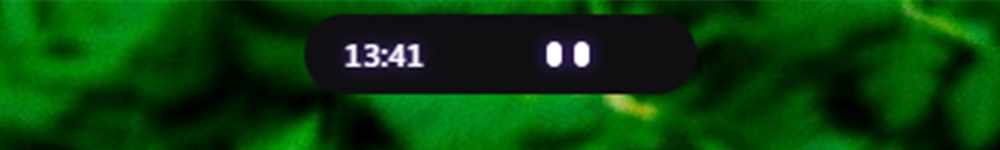
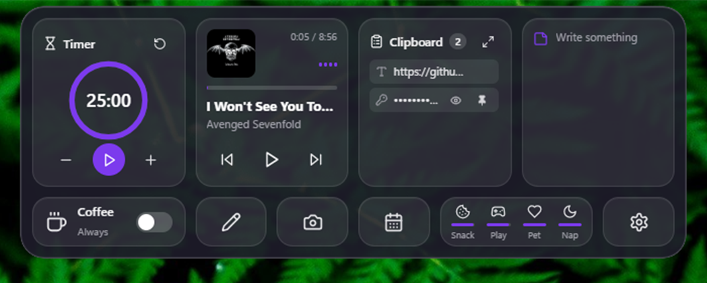

# WinNook

A Dynamic Island / notch for Windows. A small pill at the top of your screen that expands on hover into a bento grid of plugins: media, timer, clipboard history, screenshots, Teams status, and a little companion called Nook Buddy.

Built with Tauri v2 (Rust), React, TypeScript, Tailwind and Framer Motion. Every feature is a plugin on top of `@winnook/sdk`.





## Features

- Collapsed pill with live indicators, expands on hover
- Plugins: timer, media player, coffee (keep awake), notes, calendar, clipboard history (secrets are encrypted with DPAPI), screenshot, screen draw, Teams status
- Nook Buddy: eyes that follow the cursor and react to music, calls and more
- Buddy Needs: hunger, fun, love and energy shown as a small tile and in the buddy's face
- Hold Shift (configurable) and the pill dodges your mouse; `Ctrl+Alt+H` tucks it away for a few seconds
- Customizable layout, light/dark/glass themes

## Requirements

Windows 10/11, Node.js 20+, Rust 1.80+, MSVC C++ Build Tools, WebView2.

## Development

```powershell
npm install
npm run tauri dev
```

Release build:

```powershell
npm run build
cd src-tauri
cargo build --release --features tauri/custom-protocol
```

## Plugins

See [CONTRIBUTING_PLUGINS.md](CONTRIBUTING_PLUGINS.md).

## License

[MIT](LICENSE)
